# Expense Tracker

**Web app per la finanza personale: entrate, uscite e trasferimenti tra conti, alimentati direttamente dagli estratti conto delle banche.**

[](https://www.expensetracker.lol)


> **Prova la demo:** [www.expensetracker.lol](https://www.expensetracker.lol) → *Prova la demo*. Nessuna registrazione: si entra come utente di test con dati fittizi, rigenerati ogni notte.

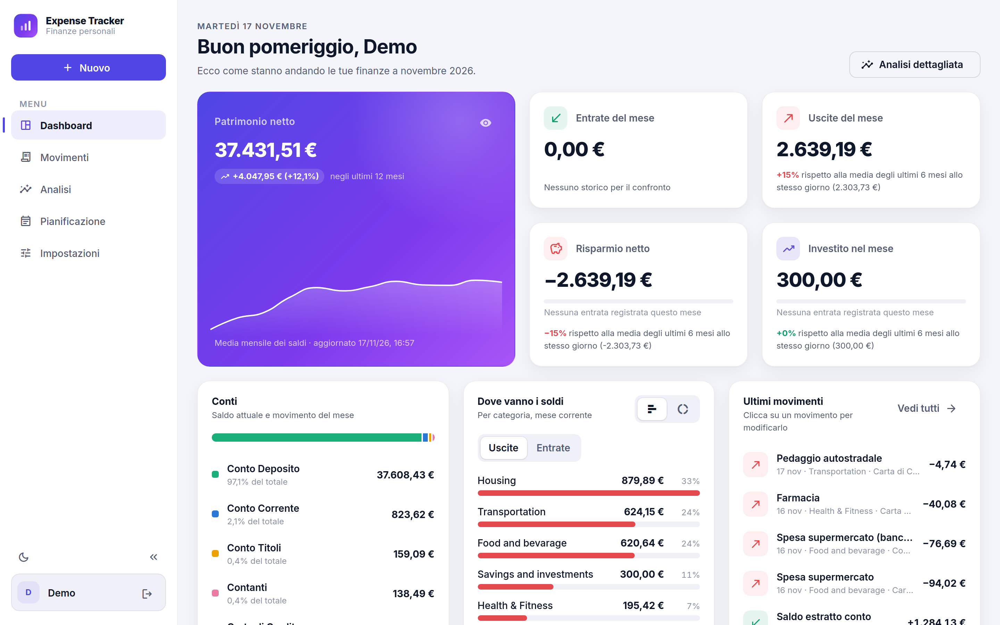

## Il progetto

Tenere traccia delle proprie finanze su più conti (banca, carta, wallet, broker) di solito significa copiare a mano i movimenti in un foglio Excel. Expense Tracker automatizza il processo: gli estratti conto vengono **importati** (caricati dall'app o salvati in una cartella OneDrive), **deduplicati**, **categorizzati** con regole a parole chiave e, quando due movimenti formano un giroconto tra i propri conti, **collegati come trasferimento** così da non falsare entrate e uscite.

È un progetto personale usato tutti i giorni, sviluppato end-to-end: dominio e API, frontend, database, infrastruttura come codice e pipeline di deploy su Azure.

## Funzionalità

| | |
|---|---|
| 📊 **Dashboard** | Patrimonio, entrate e uscite del mese, saldi dei conti, spesa per categoria, ultimi movimenti |
| 📈 **Analisi** | Andamento del patrimonio, flusso di cassa, spese per categoria e classifiche nel tempo, con card configurabili e drill-down sui movimenti |
| 🗓️ **Pianificazione** | Budget mensile per categoria, confrontato con la spesa effettiva |
| 🏦 **Import multi-banca** | CSV/XLSX di BBVA, Sella, Satispay e Trade Republic; reimportare lo stesso file non crea doppioni |
| ☁️ **Import automatico da OneDrive** | Ogni utente collega il proprio OneDrive: i file salvati nella cartella dell'app vengono importati in pochi secondi tramite notifiche Microsoft Graph |
| 🔁 **Riconoscimento dei trasferimenti** | Abbinamento automatico dei giroconti tra i propri conti, con regole per tipo di conto e IBAN |
| 🏷️ **Categorizzazione automatica** | Categorie con parole chiave e priorità, ricategorizzazione di un periodo con un clic |
| 🎨 **Temi** | Preset di stile, tema chiaro/scuro, layout responsive e installabile come PWA |
| 👤 **Multi-utente** | Login Microsoft (Entra ID), dati isolati per utente, modalità demo senza account |

## Screenshot

| Movimenti | Analisi |
|---|---|
| 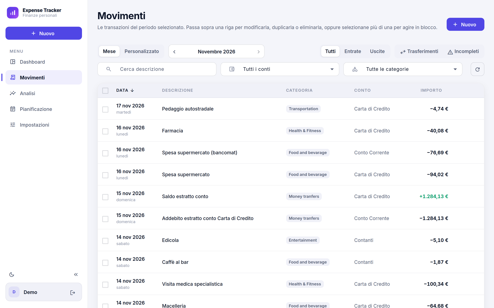 | 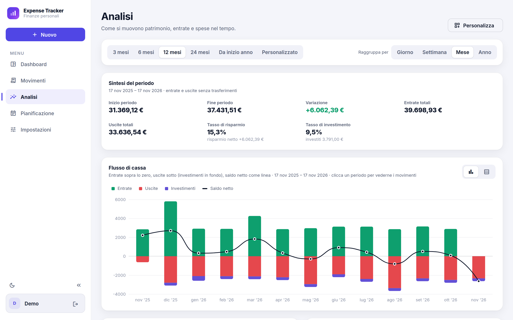 |
| **Tema scuro** | **Stili intercambiabili** |
| 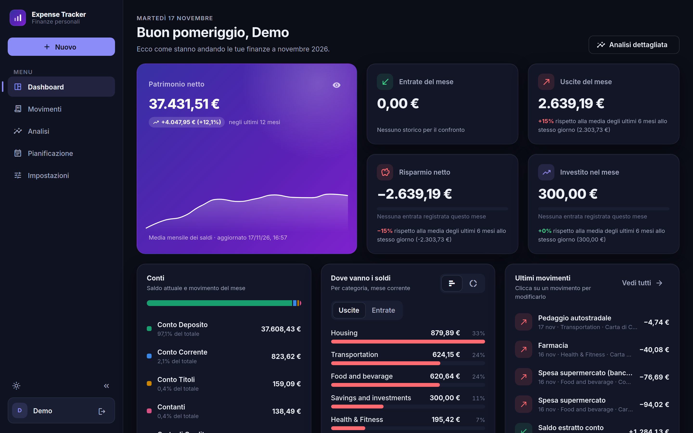 | 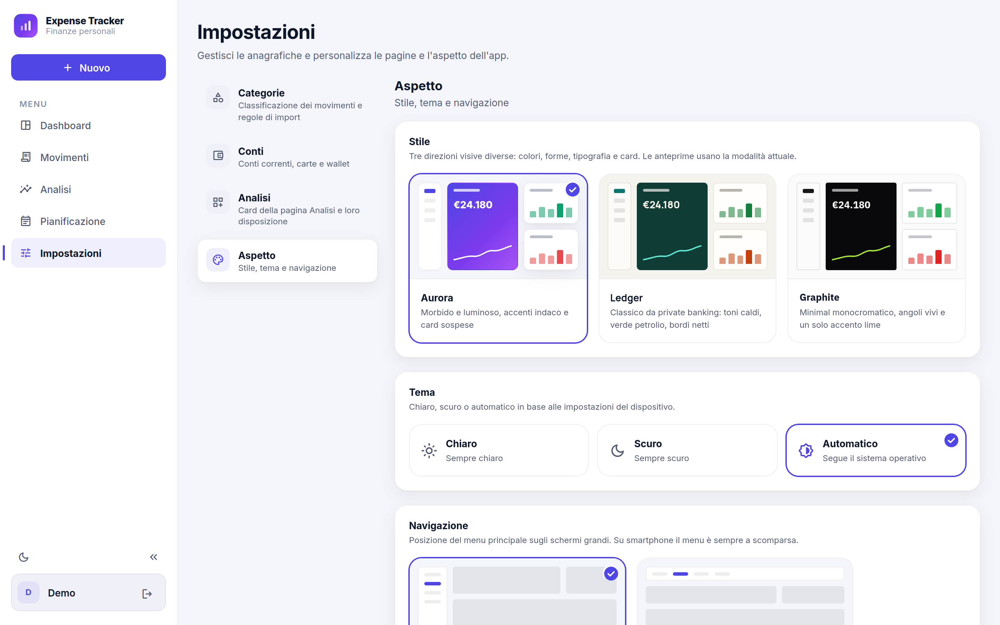 |

<p align="center">
  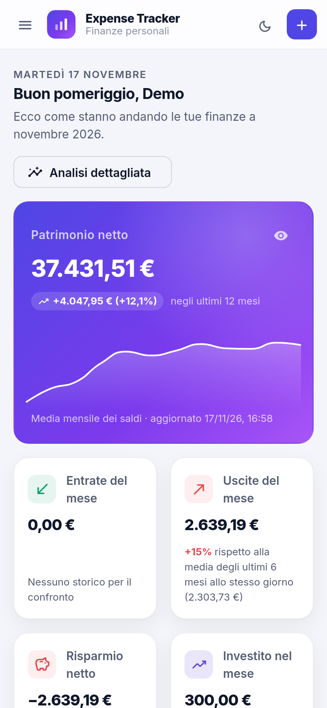
  &nbsp;&nbsp;
  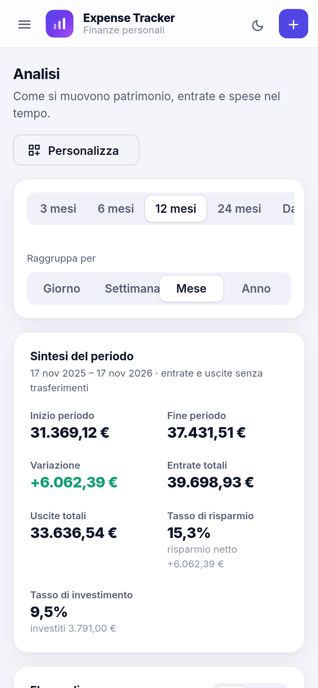
</p>

## Architettura

<!-- I diagrammi sono SVG generati dai sorgenti in docs/diagrams/*.mmd:
     npx -p @mermaid-js/mermaid-cli mmdc -b white -i docs/diagrams/<nome>.mmd -o docs/images/<nome>.svg -->

Una SPA Angular parla con un'API serverless su Azure Functions, appoggiata ad Azure SQL. Tutte le risorse sono a consumo (costo quasi nullo per un'app personale), definite in Bicep e raggiunte dalla Function App con managed identity, senza password.

<p align="center"></p>

### Backend: Clean Architecture

Le regole di business non dipendono né dal database né dall'hosting: le dipendenze vanno in un solo verso, verso il dominio.

<p align="center"></p>

Ogni richiesta attraversa una pipeline di middleware del worker: logging → gestione delle eccezioni (errori di dominio → `ProblemDetails`) → validazione del JWT e dei ruoli → function. I servizi restituiscono `Result<T>` (FluentResults) invece di lanciare eccezioni per gli errori di business, e ogni query è filtrata per utente.

### Pipeline di import

Tre ingressi (upload dall'app, OneDrive, script) convergono sullo stesso servizio. Upload e notifiche rispondono subito; il lavoro vero avviene in coda.

<p align="center">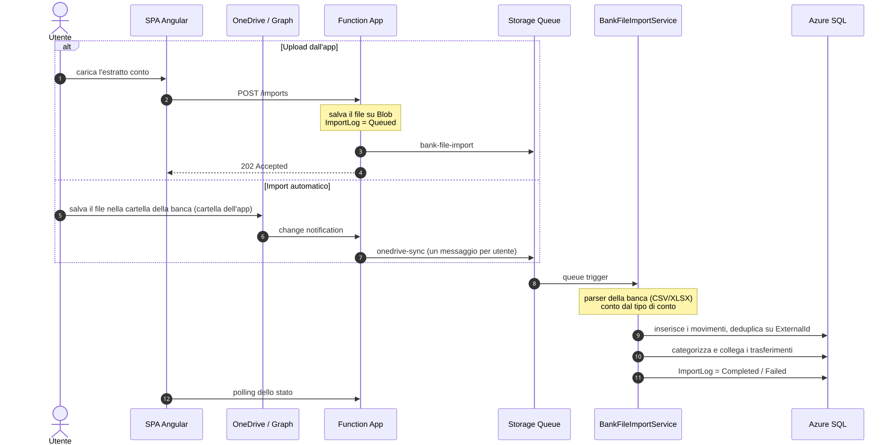</p>

### Modello dei dati

<p align="center"></p>

### CI/CD

<p align="center"></p>

GitHub Actions si autentica su Azure con **OIDC** (credenziali federate, nessun secret di lunga durata); i workflow leggono nomi e URL delle risorse dagli output del deploy dell'infrastruttura.

## Scelte tecniche

| Scelta | Perché |
|---|---|
| **Azure Functions Flex Consumption** | Costo a consumo; HTTP, code e timer nello stesso host |
| **Clean Architecture + FluentResults** | Dominio testabile e indipendente; errori di business come valori, tradotti in status HTTP in un solo punto |
| **EF Core code-first** | Schema versionato con migration, applicate dalla CI prima di ogni deploy |
| **Import asincrono (Blob + Queue)** | L'upload risponde subito anche con file lenti; lo stato in `ImportLogs` alimenta storico e avanzamento in UI |
| **Notifiche Microsoft Graph** | Import quasi in tempo reale senza polling, con accesso limitato alla sola cartella dell'app (`Files.ReadWrite.AppFolder`) |
| **Device code flow per OneDrive** | Nessun redirect né client secret; il refresh token resta in Key Vault e non passa mai dal frontend |
| **Validazione JWT nel middleware del worker** | Stesso controllo su tutte le function, indipendente da Easy Auth; tre modalità (Entra ID, demo, sviluppo) |
| **Angular standalone, signals, zoneless** | Stato reattivo con store a signal, senza NgRx |
| **Theming via token CSS** | Preset di stile intercambiabili scritti come variabili CSS, Angular Material personalizzato |
| **Bicep + estensione Microsoft Graph** | Risorse Azure e app registration Entra ID nello stesso template |
| **Managed identity ovunque** | Nessuna password verso SQL, Storage, Key Vault e Application Insights |

## Stack

- **Backend** — .NET 10, Azure Functions (isolated worker), EF Core, FluentResults, AutoMapper, Microsoft Graph SDK
- **Frontend** — Angular 22, Angular Material/CDK, ECharts (`ngx-echarts`), MSAL (`@azure/msal-browser`), PWA
- **Dati** — Azure SQL (serverless), Blob e Queue Storage, Key Vault
- **Infrastruttura** — Bicep, GitHub Actions con OIDC, Application Insights
- **Test** — xUnit, FluentAssertions (backend); Vitest (frontend)

## Avvio in locale

```powershell
# API (http://localhost:7120/api) — copiare prima local.settings.example.json in local.settings.json
cd api/RDS.ExpenseTracker.Functions; func start

# Frontend (http://localhost:5173) — configurare web/.env.local a partire da web/.env.example
cd web; npm install; npm start

# Test
dotnet test ./api/RDS.ExpenseTracker.Tests/RDS.ExpenseTracker.Tests.csproj
cd web; npm test
```

In sviluppo il frontend usa di default un bypass dell'autenticazione (login con il solo nome utente), così non serve un tenant Entra ID.

## Struttura del repository

```
api/      soluzione .NET: Domain, Application, Infrastructure, Functions, Tests
web/      frontend Angular
infra/    template Bicep, bootstrap e script di deploy
docs/     documentazione tecnica
tools/    script PowerShell e collection Postman
```

`app/` contiene il vecchio frontend React, non più pubblicato.

## Documentazione

La documentazione tecnica completa è in [`docs/`](docs/README.md): [architettura](docs/01-architettura.md), [backend](docs/02-backend.md), [frontend](docs/03-frontend.md), [dati](docs/04-dati.md), [operazioni](docs/05-operazioni.md).
