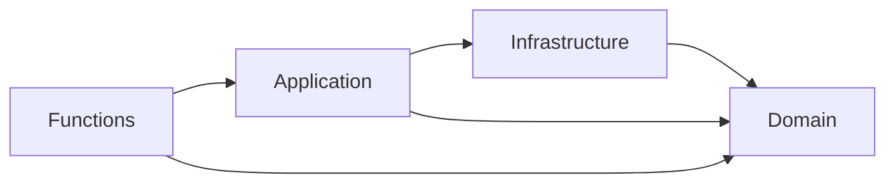
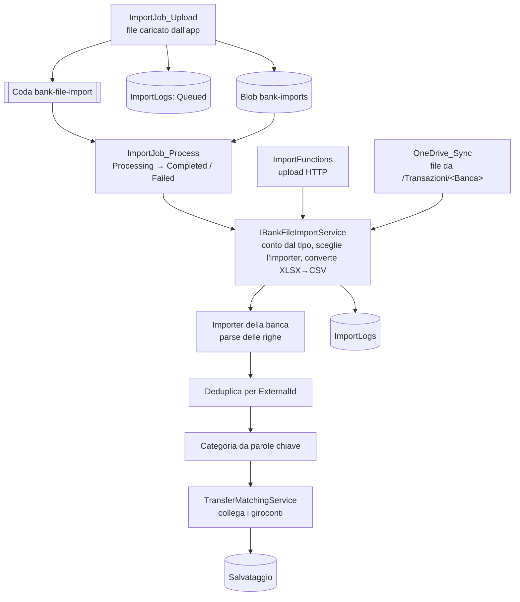

# 2. Backend

Il backend (`api/`) espone l'API REST usata dal frontend e dagli script di import, ed esegue gli import automatici e le attività pianificate. È un'app Azure Functions (isolated worker, .NET 10) organizzata in Clean Architecture.

## Layer della solution

| Progetto | Contiene |
|---|---|
| `RDS.ExpenseTracker.Domain` | Entità, enum, DTO, interfacce di repository e servizi, errori ed eccezioni di dominio |
| `RDS.ExpenseTracker.Application` | Servizi di business, importer per banca, matching dei trasferimenti, generatori dei dati demo, profilo AutoMapper |
| `RDS.ExpenseTracker.Infrastructure` | `ExpenseTrackerContext` (EF Core), repository, entity configuration, migration, client Microsoft Graph |
| `RDS.ExpenseTracker.Functions` | Function HTTP/coda/timer, middleware, autenticazione, opzioni di configurazione, DI (`Program.cs`) |
| `RDS.ExpenseTracker.Tests` | Test xUnit |

La registrazione DI è per convenzione: `AddApplicationServices()` e `AddInfrastructureServices()` registrano tutti i servizi e repository come scoped; le classi di opzioni (`IAppOptions`) sono legate alle sezioni di configurazione per riflessione.

## Pipeline di una richiesta

1. **`RequestLoggingMiddleware`** — logga metodo, path e function.
2. **`ExceptionHandlingMiddleware`** — trasforma ogni `DomainException` in `ProblemDetails` (`application/problem+json`); il resto diventa 500.
3. **`AuthenticationMiddleware`** — valida il bearer token e applica gli attributi `[RequireRole]` / `[AllowAnonymousFunction]`.
4. **Function** — risolve l'utente con `ICurrentUserAccessor`, chiama il servizio e passa il `Result` a `FunctionBase.ExecuteAsync`, che lo converte in risposta HTTP.

### Autenticazione

| Modalità | Token | Dove è ammessa |
|---|---|---|
| Entra ID | JWT validato con i metadata OIDC del tenant (firma, issuer, audience, scadenza) | Sempre |
| Demo | JWT HS256 emesso da `POST /api/auth/demo` per l'utente `test@dev.local`, senza ruoli | Se `DemoAuth:Enabled=true` |
| Sviluppo | Header `Authorization: DevUser <nome>`, nessuna validazione | Solo in `Development` (`DevAuth:Enabled=true`; altrove l'host non parte) |

**Utente interno.** Al primo accesso con Entra ID l'utente viene creato dall'oid del token (*JIT provisioning*), con le sue categorie di default. Gli accessi demo e sviluppo cercano un utente esistente per email e non lo creano mai. Gli endpoint di import accettano anche token app-only, risolti tramite `Users.AppOid`.

**Isolamento.** Ogni servizio riceve lo `userId` e i repository filtrano sui conti dell'utente: una risorsa di un altro utente risponde 404. Le uniche operazioni trasversali a tutti gli utenti sono il reset dei dati demo e la riconciliazione dei trasferimenti.

### Errori

I servizi restituiscono `Result`/`Result<T>` (FluentResults). Un errore porta un `DomainErrorKind` che diventa la corrispondente eccezione e quindi lo status:

| Kind | Status |
|---|---|
| BadRequest | 400 |
| Unauthorized | 401 |
| Forbidden | 403 |
| NotFound | 404 |
| Conflict | 409 |
| Validation | 422 |

## Endpoint

Prefisso `/api`. Tutti richiedono autenticazione salvo dove indicato. Una collection Postman con tutte le chiamate è in `tools/postman/` (da aggiornare insieme agli endpoint).

| Area | Endpoint | Scopo |
|---|---|---|
| Auth | `GET auth` | Id dell'utente interno |
| | `POST auth/demo` *(anonimo)* | Token per la modalità demo |
| Conti | `POST account/query`, `GET account/{id}` | Ricerca paginata, dettaglio |
| | `GET account/{id}/availability` | Saldo (somma dei movimenti) |
| | `POST account`, `PUT account` | Creazione (bulk), modifica (nome, IBAN, tipo di conto) |
| | `GET account-type` | Catalogo dei tipi di conto, con quelli importabili da file |
| Categorie | `POST category/query`, `GET category/{id}`, `GET category/default` | Ricerca, dettaglio, categoria predefinita |
| | `POST category`, `PUT category`, `DELETE category/{id}` | CRUD; l'eliminazione sposta i movimenti sulla predefinita |
| | `POST category/sync` | Ricategorizza i movimenti di un periodo con le parole chiave |
| Movimenti | `POST transaction/query` | Elenco paginato con filtri e ordinamento |
| | `GET transaction/{id}`, `GET transaction/latest`, `GET transaction/month-options` | Dettaglio, ultimo movimento, mesi disponibili |
| | `POST transaction`, `PUT transaction`, `DELETE transaction/{id}` | CRUD |
| | `GET transaction/landing` | Aggregati della dashboard |
| | `POST transaction/series`, `POST transaction/stock` | Serie temporali: flussi per periodo, saldo medio per periodo |
| Trasferimenti | `GET transfer`, `GET transfer/{id}` | Elenco, dettaglio |
| | `POST transfer`, `PUT transfer/{id}`, `DELETE transfer/{id}` | CRUD (ogni trasferimento sono due movimenti collegati) |
| Preferenze | `GET user/analytics-layout`, `PUT user/analytics-layout` | Layout della pagina Analisi (card visibili, ordine, larghezza); `null` se mai personalizzato |
| Demo | `POST demo/generate` | Rigenera i dati dell'utente demo (solo utenti con `IsDemo`) |
| Import dall'app | `POST imports` | Multipart `file` (CSV/XLSX, max 10 MB) + `accountId`: salva il file e lo accoda, risponde 202 con l'import `Queued` (non per l'utente demo) |
| | `POST imports/query` | Storico paginato degli import dell'utente (filtro opzionale per stato) |
| Import *(ruolo `Files.Sender`)* | `POST import/{banca}-csv`, `…-csv/stream`, `…-xlsx` | Import di un estratto conto (banca: `bbva`, `sella`, `satispay`, `traderepublic`) |
| | `POST import/excel`, `import/excel/base64`, `import/excel/stream` | Import del formato Excel storico |
| | `POST import/transfers/reconcile` | Collega a posteriori i trasferimenti (`dryRun` opzionale) |
| | `POST import/test-seed` | Rigenera l'utente di test con 5 anni di dati |
| OneDrive | `POST onedrive/notifications` *(anonimo)* | Notifiche Microsoft Graph |

## Pipeline di import

- **Conto di destinazione** — si risolve dal tipo di conto: è il conto dell'utente il cui `AccountType` è elaborato da quella banca (al massimo uno per tipo). Se l'utente non ce l'ha, l'import fallisce: i conti non vengono più creati in automatico. Il formato Excel interno resta multi-conto (nomi dei conti nel file). Il sotto-conto Trade Republic per le righe TRADING si riconosce per nome (`TradeRepublicCsv:TradingAccountName`); se manca, le righe vanno sul conto Trade Republic.
- **Import asincrono dall'app** — `ImportJob_Upload` valida conto e file, salva il file nel container `bank-imports` dello storage dell'host, registra l'import come `Queued` e accoda l'id su `bank-file-import`. `ImportJob_Process` lo porta a `Processing`, esegue la stessa pipeline sul conto scelto e chiude il log come `Completed` o `Failed` (nessun retry sugli errori dell'import; un messaggio duplicato per un import già concluso è ignorato).
- **Importer per banca** — ognuno conosce il formato del proprio estratto conto e da dove ricavare l'`ExternalId` (BBVA: impronta SHA-256 dei campi; le altre: id nativo della riga).
- **Deduplica** — le righe con un `ExternalId` già presente tra i movimenti dell'utente sono scartate; un indice univoco sul database fa da rete di sicurezza.
- **Categorie** — assegnate cercando le parole chiave delle categorie dell'utente nella descrizione (vince la priorità più bassa); senza corrispondenza si usa la categoria predefinita.
- **Trasferimenti** — riconosciuti in tre modi: IBAN della controparte uguale all'IBAN di un altro conto dell'utente; regole configurate in `TransferMatching:Rules` (tipo di conto + testo della descrizione sui due lati); a posteriori, con la riconciliazione, anche per categoria di sistema `MoneyTransfers` con importo opposto entro 3 giorni.
- **Tracciamento** — ogni import (riuscito o fallito) scrive una riga in `ImportLogs` con stato, periodo coperto, movimenti nuovi, duplicati scartati ed eventuali errori; gli import sincroni (HTTP, OneDrive) nascono già conclusi.
- **OneDrive** — un file importato viene spostato in `<Banca>/Importati`, uno fallito in `<Banca>/Errori`. Un lock sul database impedisce due sincronizzazioni contemporanee; la posizione della delta query è salvata in `OneDriveSyncStates`.

Gli script PowerShell in `tools/scripts/` chiamano gli endpoint di import.
