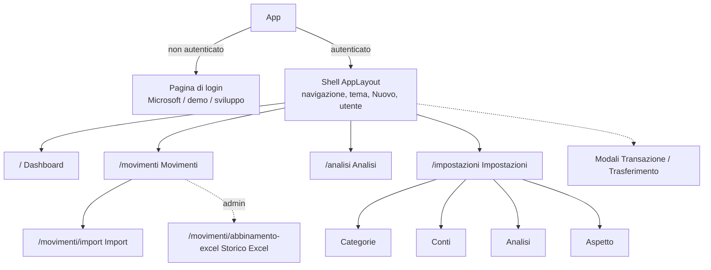

# 3. Frontend

Il frontend (`web/`) è una SPA Angular 22 in italiano: componenti standalone, signals, change detection zoneless. Mostra la panoramica dei conti, l'elenco dei movimenti, le analisi nel tempo e le impostazioni; tutte le modifiche passano dall'API del backend.

## Organizzazione dell'interfaccia

| Pagina | Contenuto |
|---|---|
| **Dashboard** `/` | Patrimonio attuale con andamento a 12 mesi (importi nascondibili); entrate, uscite, risparmio netto con tasso di risparmio, investito nel mese (uscite della categoria investimenti) con tasso di investimento, a confronto con la media; ripartizione per conto (esclusi i conti con saldo zero); "Dove vanno i soldi" per categoria (barre o torta); ultimi movimenti |
| **Movimenti** `/movimenti` | Tabella paginata e ordinabile con filtri per periodo (mese, con frecce o calendario anno → mese limitato ai mesi con movimenti, oppure intervallo), tipo (entrate/uscite), solo trasferimenti, descrizione (ricerca parziale, case insensitive), conti e categorie; il filtro **Trasferimenti** mostra i movimenti collegati a un trasferimento o in Money transfers (con **Incompleti** solo quelli segnalati); un triangolo di warning segnala le righe il cui trasferimento non ha entrambi i rami o che sono in Money transfers senza trasferimento (con etichetta distinta) e apre una modale per scegliere il movimento corrispondente (altro conto, importo opposto, stesso mese ±1 mese; se ce n'è uno solo è preselezionato), che prende la data del movimento di partenza; l'ultima opzione, segnata come **Nuovo**, crea il movimento mancante su un conto a scelta e viene salvata solo alla conferma; menu per riga con modifica, duplica (apre la modale di inserimento prepopolata con i dati del movimento), scomponi (non per i movimenti collegati a un trasferimento completo: modale per dividerlo in più voci con gli stessi dati, importi modificabili, aggiunta/rimozione di voci, ripartizione in parti uguali e conferma solo quando la somma corrisponde all'originale) ed eliminazione; selezione multipla (righe della pagina corrente) con barra di azioni per eliminare o assegnare una categoria a tutti i selezionati. I filtri si possono impostare da URL (`periodo`, `categoria`, `tipo`, usati dal drill-down di Analisi; con `da=analisi` compare il pulsante **Torna all'analisi**). Se l'utente ha conti di un tipo importabile (non per l'utente demo): bottone **Importa** (modale con conto e file CSV/XLSX, caricato e accodato per l'import asincrono) e tab **Import** |
| **Import** `/movimenti/import` | Tab di Movimenti: storico degli import da file (dall'app, OneDrive, script) con stato, conto, periodo, movimenti nuovi e già presenti, errore; quelli in coda o in elaborazione si aggiornano da soli |
| **Abbinamento storico Excel** `/movimenti/abbinamento-excel` | Solo admin (guard `adminGuard` e bottone **Abbina Excel** in Movimenti): si carica `Spese.xlsx` e si sceglie un mese; a sinistra le righe del foglio, a destra i movimenti a DB dello stesso mese più gli ultimi 7 giorni del precedente e i primi 7 del successivo, con le coppie suggerite numerate su entrambi i lati. Si abbina a mano selezionando una riga e poi un movimento, oppure si toglie una riga con **Segna come abbinata**. Le righe abbinate, salvate o segnate escono da entrambe le liste, così restano in vista quelle mancanti; sono ricordate per file e foglio nel `sessionStorage` e tornano visibili con **Mostra abbinati** (con l'azione per riportarle tra le righe da gestire). Filtro per conto. Un triangolo di warning sulla riga Excel e sulla coppia segnala che nel periodo esiste già un movimento abbinato in una sessione precedente, sullo stesso conto e con la stessa somma, la cui descrizione contiene quella Excel. Le righe di **Contanti e Hype** (conti senza import automatico) non si abbinano: al caricamento del foglio si apre una finestra dedicata (riapribile dalla barra) per crearle come nuovi movimenti, con testo e categoria modificabili; un triangolo di warning, con il dettaglio al passaggio del mouse, segnala un movimento già esistente sullo stesso conto nello stesso mese con stesso nome e stessa somma (quelle righe partono escluse). Sotto, per ogni coppia, descrizione e categoria da salvare (modificabili) e inclusione; **Salva** aggiorna i movimenti e ricarica il mese. **Ripristina mese**, dopo conferma, annulla gli abbinamenti del mese a DB (elimina i movimenti creati dallo storico, ripristina descrizione e categoria degli altri) e azzera le righe gestite nella sessione |
| **Analisi** `/analisi` | Periodo (3–24 mesi, da inizio anno, personalizzato) e granularità (giorno, settimana, mese, anno), poi le card scelte dall'utente in Impostazioni → Analisi (ordine e larghezza; griglia a 6 colonne da 1200px, sotto tutte a piena larghezza): sintesi del periodo, flusso di cassa (con la quota investita delle uscite e il tasso di investimento), patrimonio totale e per conto, classifica dei periodi, spese/entrate per categoria, classifica delle categorie. Ogni grafico ha anche la vista tabella. Cliccando un periodo nel flusso di cassa o nelle categorie si apre Movimenti filtrato su quel periodo (e sulla categoria/tipo cliccati); filtri e viste sono nei query param, quindi il back del browser ripristina la pagina com'era |
| **Impostazioni** `/impostazioni?sezione=` | **Categorie**: CRUD con parole chiave e priorità, sincronizzazione delle categorie su un periodo (classifica per parole chiave solo i movimenti ancora nella categoria predefinita). **Conti**: card con saldo e netto del mese, creazione e modifica di nome, IBAN e tipo di conto (un tipo per conto; i tipi delle banche abilitano l'import da file). **Analisi**: scheletro della pagina Analisi su cui trascinare (CDK drag and drop) le card visibili e quelle nascoste; le card verticali (classifiche) occupano 1/3 o 1/2 della riga, quelle orizzontali (grafici per periodo) 1/2, 2/3 o tutta; il layout è salvato a DB al clic su Salva. **Aspetto**: stile, tema chiaro/scuro/automatico, navigazione laterale o superiore |

**Shell.** Barra laterale comprimibile (default) o barra superiore, a scelta in Aspetto; sotto i 900px diventa una barra compatta con menu a scomparsa. Il pulsante **Nuovo** apre da qualunque pagina le modali di nuova transazione o nuovo trasferimento, montate una sola volta nella shell.

**Login.** Se l'utente non è autenticato l'app mostra la pagina di login al posto della shell, senza cambiare URL: dopo l'accesso si torna alla pagina richiesta.

## Struttura del codice (`web/src/app/`)

| Cartella | Contenuto |
|---|---|
| `core/api/` | `ApiClient`, servizi `*.api.ts` per risorsa, interceptor (auth, errori), notifiche |
| `core/auth/` | `AuthService`, istanza MSAL, sessioni demo e sviluppo |
| `core/config/` | Variabili d'ambiente, URL dell'API, route, voci di menu |
| `core/models/` | Tipi dei payload scambiati con l'API |
| `core/pwa/` | Avviso di nuova versione del service worker |
| `core/state/` | Store a signal condivisi |
| `core/theme/` | `ThemeService`, preset di stile, palette dei grafici |
| `core/utils/` | Formattazione di importi, date e periodi |
| `features/` | Pagine: `dashboard`, `transactions`, `imports`, `analytics`, `settings` |
| `layout/` | Shell e azioni dell'intestazione |
| `pages/auth/` | Pagine di login |
| `shared/ui/`, `shared/charts/` | Componenti riusabili (tabella dati, drawer, modali, ricerca, ...) e grafici ECharts |

Le pagine sono caricate in lazy (`app.routes.ts`); anche ECharts viene scaricato solo alla prima pagina con un grafico.

## Stato e dati

- **Store** (`core/state/`) — servizi `providedIn: "root"` con signal: `AccountsStore`, `CategoriesStore` e `AccountTypesStore` (anagrafiche caricate una volta dalla shell), `TransactionsStore`, `ImportsStore` (conti importabili, upload, storico; finché ci sono import in corso li ricontrolla ogni pochi secondi e ne notifica l'esito), `TransactionsTableStore` (filtri, ordinamento, paginazione della tabella), `AnalyticsLayoutStore` (layout della pagina Analisi; il catalogo delle card è in `core/config/analytics-cards.ts`), `AppearanceStore` (preferenze di aspetto: caricate dalla shell, poi salvate a ogni modifica), `QuickActionsService` (modali). Nessuna libreria di state management.
- **Aggiornamento** — dopo ogni modifica `TransactionsStore` incrementa `dataVersion`; dashboard, analisi e conti lo osservano e ricaricano i propri aggregati. Lo fa anche quando un import da file si conclude con nuovi movimenti.
- **API** — tutte le chiamate passano da `ApiClient`, che condivide le richieste identiche in volo. L'interceptor di autenticazione aggiunge l'header; quello degli errori estrae il messaggio dai problem details, lo mostra in una snackbar e rilancia l'errore.

## Autenticazione

`AuthService` inizializza MSAL prima del primo render e gestisce tre modalità:

| Modalità | Quando | Header |
|---|---|---|
| Entra ID (MSAL redirect) | Default | `Bearer` con scope `api://…/access_as_user` |
| Demo | Pulsante "Prova la demo" (`VITE_DEMO_LOGIN_ENABLED`) | `Bearer` emesso da `POST /api/auth/demo` |
| Sviluppo | `npm start`, salvo `VITE_DEV_AUTH_BYPASS=false` | `DevUser <nome>` |

## PWA

L'app è una Progressive Web App installabile (Chrome/Edge: icona di installazione nella barra degli indirizzi), con finestra propria e scorciatoie a Movimenti e Analisi. Manifest e icone sono in `public/` (`manifest.webmanifest`, `icons/`); il service worker è quello di Angular (`@angular/service-worker`, configurato in `ngsw-config.json`) ed è attivo solo nelle build di produzione.

Il service worker mette in cache solo la shell (JS, CSS, icone, Google Fonts): le chiamate all'API passano sempre dalla rete, quindi senza connessione l'app si apre ma non mostra dati. Quando viene pubblicata una nuova versione `AppUpdateService` propone di ricaricare; `staticwebapp.config.json` serve `index.html`, `ngsw.json` e `ngsw-worker.js` senza cache HTTP, così gli aggiornamenti vengono rilevati subito.

## Temi

Tre preset di stile in `core/theme/stylePresets.ts` (`aurora` di default, `ledger`, `graphite`), ognuno in versione chiara e scura. `ThemeService` scrive i token del preset attivo come variabili CSS su `:root` (`--app-*` per l'app, `--mat-sys-*` per Angular Material); i componenti li usano con `var(--app-…)` e i grafici con `ThemeService.tokens()`. Le preferenze di aspetto sono salvate a DB per utente (`AppearanceStore`, assenti = predefinite); `localStorage` ne tiene una copia usata solo fino al caricamento, per evitare il cambio di stile al primo render.

La palette dei grafici (`chartColors.ts`) ha 8 colori in ordine fisso, verificati per il daltonismo; ogni conto o categoria ha sempre lo stesso colore, mentre entrate e uscite usano i colori semantici del preset.

## Tipografia e spaziature

Regole valide per tutti i componenti, Material compresi:

- **Testo: 4 grandezze**, definite come variabili in `styles.scss` e usate sempre tramite `var(--app-text-…)`, mai con valori diretti:

  | Variabile | Grandezza | Uso |
  |---|---|---|
  | `--app-text-sm` | 12px (0.75rem) | etichette, didascalie, intestazioni di tabella, chip, tooltip, assi dei grafici |
  | `--app-text-md` | 14px (0.875rem) | testo base, controlli (pulsanti, campi, dropdown), voci di elenco |
  | `--app-text-lg` | 18px (1.125rem) | titoli di card e dialog, importi in evidenza |
  | `--app-text-xl` | 28px (1.75rem) | titolo di pagina, importo principale |

  La gerarchia si ottiene con peso (400/600/650) e colore (`--app-text`, `--app-text-secondary`, `--app-text-muted`), non con grandezze intermedie. La typescale di Angular Material è ricondotta alle stesse 4 grandezze con `mat.theme-overrides`. Le icone hanno grandezze proprie (14, 18, 20, 24px).
- **Spaziature** (padding, margin, gap): solo 2px o multipli di 4px — 4, 8, 12, 16, 20, 24, 32…
- **Font**: uno solo per volta, quello del preset di stile attivo (Inter, Manrope o IBM Plex Sans); le icone usano Material Symbols Rounded.
