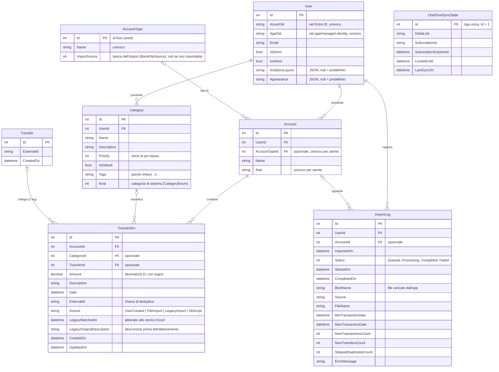

# 4. Dati

Ogni utente possiede i propri conti e le proprie categorie; i movimenti appartengono a un conto e quindi, indirettamente, a un utente. Un trasferimento tra due conti è rappresentato da due movimenti (uno negativo, uno positivo) collegati da un record `Transfer`. Il database è SQL Server, gestito con EF Core code-first (`ExpenseTrackerContext`, configurazioni in `Infrastructure/EntityConfigurations/`).

## Schema



| Tabella | Ruolo |
|---|---|
| `Users` | Utente interno, creato al primo accesso; `IsDemo` abilita la rigenerazione dei dati demo; `IsAdmin` le funzioni di amministrazione (la migration lo assegna all'utente con id 1); `AnalyticsLayout` è il layout della pagina Analisi in JSON (id e larghezza delle card, il catalogo è nel frontend); `Appearance` le preferenze di aspetto in JSON (stile, modalità, navigazione). Il reset schedulato dell'utente demo le riporta entrambe a `NULL` |
| `Accounts` | Conto finanziario; l'IBAN serve a riconoscere i trasferimenti negli import, il tipo a scegliere il conto di destinazione |
| `AccountTypes` | Catalogo fisso dei tipi di conto (BBVA, Satispay, Trade Republic, Sella, Revolut, Contanti, Hype, PayPal), creato dalla migration; i primi quattro hanno un import da file |
| `Categories` | Categorie dell'utente; quelle con `Kind` valorizzato sono le 11 di sistema create con l'utente |
| `Transactions` | Movimento; importo positivo = entrata, negativo = uscita; `Source` ne indica l'origine (inserito dall'utente, import da file, creato dallo storico Excel, scritto da script SQL diretto sul DB); `LegacyMatchedAt` indica che è stato abbinato a una riga dello storico Excel e `LegacyOriginalDescription` conserva la descrizione precedente al primo abbinamento |
| `Transfers` | Collega le due metà di un trasferimento |
| `ImportLogs` | Stato ed esito di ogni import di file; per gli import dall'app anche il blob del file |
| `OneDriveSyncStates` | Stato dell'import OneDrive: posizione della delta query, subscription Graph, lock |

## Vincoli principali

| Vincolo | Scopo |
|---|---|
| Univoco filtrato `Transactions (AccountId, ExternalId)` | Impedisce di importare due volte lo stesso movimento sullo stesso conto |
| Univoco filtrato `Accounts (UserId, Iban)` | Un IBAN identifica un solo conto per utente (utenti diversi possono condividerlo) |
| Univoco filtrato `Accounts (UserId, AccountTypeId)` | Un conto per tipo per utente: gli import risolvono il conto dal tipo |
| Univoco filtrato `Categories (UserId, Kind)` | Al più una categoria di sistema per tipo e per utente |
| Univoci filtrati `Users.AzureOid`, `Users.AppOid` | Un utente per identità |
| Indici `ImportLogs (UserId, ImportedOn)`, `(UserId, Status)` | Storico cronologico e import in corso |

| Relazione | Alla cancellazione del padre |
|---|---|
| User → Account, User → Category, Account → Transaction, AccountType → Account | Bloccata (Restrict) |
| Category → Transaction, Transfer → Transaction | Il movimento resta, il riferimento diventa `NULL` |
| User → ImportLog | I log vengono eliminati (Cascade) |
| Account → ImportLog | Il log resta, `AccountId` diventa `NULL` |

## Regole sui dati

- **Saldo calcolato** — nessun saldo è memorizzato: si ottiene sommando i movimenti del conto.
- **Categorie di sistema** — `CategoryEnum` (Default, MoneyTransfers, WorkIncomes, Housing, HealthAndFitness, FoodAndBeverage, Transportation, Entertainment, Clothes, SavingsAndInvestments, Gifts) definisce le categorie create per ogni utente. I valori non sono id: il codice risolve l'id dell'utente tramite `Category.Kind`.
- **Giroconti esclusi dai flussi** — nei totali di entrate/uscite un movimento è un trasferimento se ha `TransferId` oppure è nella categoria `MoneyTransfers`. Saldi e patrimonio li includono sempre.
- **Conto degli import** — un estratto conto bancario va sul conto dell'utente del tipo di quella banca; se manca, l'import fallisce. Solo il formato Excel interno crea i conti che nomina e non trova.

## Migration

Le migration sono in `Infrastructure/Migrations/`; in produzione le applica la pipeline prima di ogni deploy del backend (vedi [Operazioni](05-operazioni.md)).

```powershell
dotnet ef migrations add <Nome> -p api/RDS.ExpenseTracker.Infrastructure -s api/RDS.ExpenseTracker.Functions -o Migrations
dotnet ef database update -p api/RDS.ExpenseTracker.Infrastructure -s api/RDS.ExpenseTracker.Functions
```
